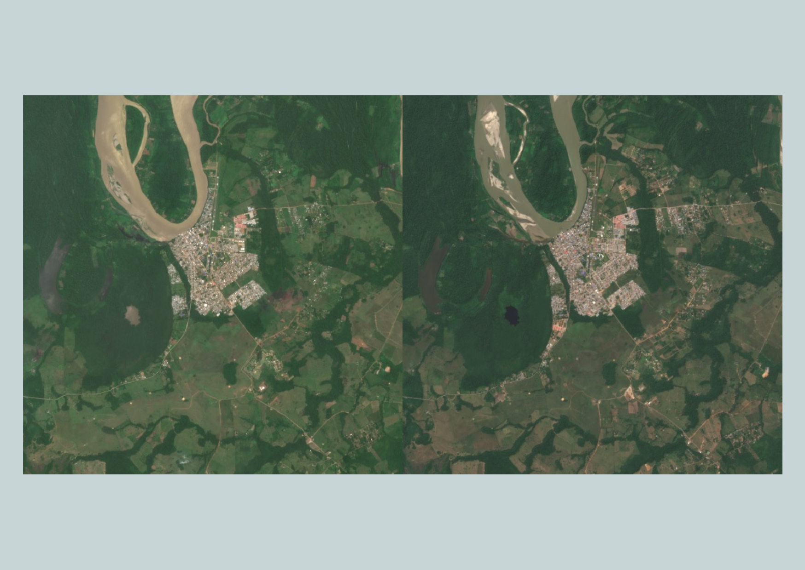

# Ingeniería de Sistemas y Deforestación en Colombia

## Introducción

Este proyecto académico explora cómo usar imágenes satelitales para detectar cambios en la cobertura vegetal de la Amazonía colombiana. El caso de estudio compara escenas de 2019 y 2024 en los alrededores de San José del Guaviare. Los scripts usan Python y Google Earth Engine para consultar imágenes Sentinel-2, generar vistas en color natural, calcular un índice de vegetación y estimar la superficie donde disminuyó la cobertura vegetal densa según ese índice.

El [informe académico](Systems%20Engineering%20and%20Deforestation%20Project%20in%20Colombia%20Third%20Send-3.docx) documenta el contexto, la metodología y los resultados. También presenta **EcoAlerta-Amazonia**, una propuesta de arquitectura para automatizar el monitoreo y generar alertas tempranas.

## Requisitos

- Python 3.12, la versión usada en el estudio.
- Una cuenta de Google con acceso a un proyecto de Google Cloud registrado en Earth Engine y con la API habilitada. [Guía de autenticación de Earth Engine](https://developers.google.com/earth-engine/guides/auth?hl=es-419)

## Instalación y uso

1. Desde la carpeta del repositorio, crea un entorno virtual en PowerShell, instala la biblioteca cliente de Earth Engine e inicia sesión con tu cuenta de Google. [Guía de instalación de la API de Python](https://developers.google.com/earth-engine/guides/python_install?hl=es-419)

   ```powershell
   python -m venv .venv
   .\.venv\Scripts\python.exe -m pip install earthengine-api
   .\.venv\Scripts\earthengine.exe authenticate
   ```

2. Si usas otro proyecto de Google Cloud, reemplaza `proyecto-amazonia-mariana` en la llamada a `ee.Initialize(project=...)` del script que quieras ejecutar.
3. Ejecuta `SegundaPrueba.py` para comprobar la conexión. Si la consulta tiene éxito, la terminal muestra el identificador de la escena seleccionada para 2024.

   ```powershell
   .\.venv\Scripts\python.exe .\SegundaPrueba.py
   ```

Para generar los enlaces de la comparación visual y calcular el área estimada de cambio, ejecuta los scripts siguientes. Los enlaces se pueden abrir en el navegador.

```powershell
.\.venv\Scripts\python.exe .\QuintaPrueba.py
.\.venv\Scripts\python.exe .\SextaPrueba.py
```

## Scripts

| Archivo | Función |
| --- | --- |
| [PrimeraPrueba.py](PrimeraPrueba.py) | Prueba inicial de configuración de Google Earth Engine. |
| [SegundaPrueba.py](SegundaPrueba.py) | Consulta imágenes de 2024 y muestra el identificador de la escena seleccionada. |
| [TerceraPrueba.py](TerceraPrueba.py) | Genera un enlace a una imagen de 2024 en color natural. |
| [CuartaPrueba.py](CuartaPrueba.py) | Genera un enlace al mapa del índice de vegetación de 2024. |
| [QuintaPrueba.py](QuintaPrueba.py) | Genera enlaces a vistas en color natural de 2019 y 2024. |
| [SextaPrueba.py](SextaPrueba.py) | Cuenta los píxeles que cruzan el umbral de vegetación entre 2019 y 2024 y convierte el total a hectáreas. |

## Metodología y resultados

1. **Selección de imágenes.** Los scripts consultan la colección de reflectancia superficial armonizada `COPERNICUS/S2_SR_HARMONIZED` de Sentinel-2. Los scripts de visualización filtran escenas con menos del 10 % de nubosidad. El script de estimación de superficie selecciona la escena con menor nubosidad disponible de cada periodo. [Catálogo de Sentinel-2 en Earth Engine](https://developers.google.com/earth-engine/datasets/catalog/COPERNICUS_S2_SR_HARMONIZED)
2. **Cálculo del NDVI.** El índice de vegetación de diferencia normalizada se calcula como `(B8 - B4) / (B8 + B4)`. `B8` corresponde al infrarrojo cercano y `B4` al rojo. [Bandas de Sentinel-2](https://developers.google.com/earth-engine/datasets/catalog/COPERNICUS_S2_SR_HARMONIZED#bands)
3. **Estimación de superficie.** En el área de estudio, `SextaPrueba.py` cuenta los píxeles con `NDVI > 0.6` en 2019 y `NDVI ≤ 0.6` en 2024. El cálculo usa una escala de 10 metros y convierte cada píxel contado, equivalente a 100 m², a hectáreas.

El informe registra una estimación de **1.044,36 hectáreas** para el área analizada. El resultado depende de las escenas seleccionadas y del umbral aplicado. Distinguir la deforestación de otros cambios en la vegetación requiere validación independiente.

### Comparación satelital de San José del Guaviare



*Escenas Sentinel-2 en color natural. La imagen de 2019 está a la izquierda y la de 2024 está a la derecha.*
